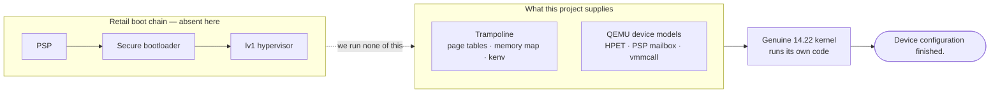

<div align="center">

# PS5-1422-REHOST

**The first publicly documented rehost of a current-generation console kernel on a PC.**

A genuine PlayStation 5 **14.22** kernel, booted under QEMU on commodity AMD hardware with
**no Sony hypervisor**, to its own `Device configuration finished.` — with every synthetic it
took to get there *registered, observable, and revertible*.


</div>

---

The kernel is not emulated. It is the real signed-build kernel (`r230580/releases/14.22`,
Oct 27 2026), running its own code on a native x86-64 CPU. What this project supplies is the
*boot chain* a console provides and a PC does not — page tables, memory map, device topology,
loader environment, hypercall services — each reconstructed from the only specification that
exists: the kernel's own expectations, read one fault at a time.

## The proof

Straight from [`evidence/logs/session148-serial.log`](evidence/logs/session148-serial.log)
(the kernel's own output; elisions marked, duplicate console lines removed):

```console
PS5-TRAMP-1422: booting KIMUNAKI 14.22 kernel
PS5-TRAMP-1422: entering long mode -> btext 0xffffffff8045a6c0
...
SIE CONFIDENTIAL
Copyright (C) 2026 Sony Interactive Entertainment Inc.
...
r230580/releases/14.22 Oct 27 2026 02:17:44 amd64
mDBG: Kernel Build ID = dc496d74ef9d4813
Memory mode: 1: PPR16  (GDDR6 : 16 GiB, DDR5 : 0 GiB)
...
Device configuration finished.
```

And the run is **valid**, not a trampoline falling into memory — the companion
[`gdbstep`](evidence/logs/session148-gdbstep.log) log records the gate that proves the kernel's
own entry executed:

```console
=== BTEXT-HIT: kernel entry 0xffffffff8045a6c0 REACHED (run valid) ===
```

## The idea, in one diagram



Every departure from genuine Sony behaviour needed to stand in for that absent chain is one row in
the [synthetic register](docs/synthetic-register.md) — address, what it pretends to be, what the
kernel receives, and the condition under which it is removed. **56 synthetics, all accounted for.**

## From mostly-synthetic toward the kernel's own code

The method — *remove what never runs, model what is, guards aren't inert* — drives the patch count
down and measures it as a curve. Every step is confirmed by a boot that still prints the marker:

```text
baseline   423  █████████████████████████   static census
           413  ████████████████████████▍   removed zero-reference dead stubs
           106  ██████▎                     removed unreached stubs (only 7 of 324 run)
            71  ████▏                       removed unreached hypercalls (only 6 of 41 run)
            65  ███▊                        modelled the 6 reached hypercalls in QEMU
            62  ███▋                        modelled the PSP mailbox as a QEMU device
```

**423 → 62 kernel patches, −85%, boot-proven.** The reachability lever collapsed the fear that
~330 code holes were an irreducible floor — only 7 are genuinely executed. What remains is the
platform itself: loader plumbing, two absent-crypto refuses no QEMU can satisfy, and the device
models still to be written. The curve is the publishable claim; the floor is honest, not zero.

## What is claimed

1. **A documented rehost, not a demo.** A current-gen console kernel reaches device-config
   completion on a PC, and *every* synthetic that made it possible is written down with its
   address and its revert condition. The accounting is as much the contribution as the boot.
2. **A reusable method.** The three-move discipline above, measured as a curve — see
   [`METHODOLOGY.md`](METHODOLOGY.md).
3. **A security-research harness.** Reaching device-config exercises the kernel's device-init,
   driver-attach, and parser surface under instrumentation. Any vulnerabilities are handled by
   private coordinated disclosure and are **not** part of this release.

## Start here

| If you want to… | Read |
|---|---|
| understand *how* it was done and reproduce the approach | [`METHODOLOGY.md`](METHODOLOGY.md) |
| see exactly *what* was faked, and why it is honest | [`docs/synthetic-register.md`](docs/synthetic-register.md) |
| run it against your own kernel | [`docs/reproducing.md`](docs/reproducing.md) |
| read the full, unedited run logs | [`evidence/logs/`](evidence/logs/) |

## What is *not* here

By design this repository contains **no firmware**: no kernel or hypervisor image, no raw dump, no
reconstructed code, no keys, no content. You supply your own legally obtained 14.22 kernel; the
harness builds around it. Artifact identities and SHA-256 hashes are in
[`docs/provenance.md`](docs/provenance.md) so a reproduction can be checked without anything
changing hands. There is no game execution and no path to it.

<details>
<summary><b>Repository layout</b></summary>

```
PS5-1422-REHOST/
├── METHODOLOGY.md                the method and the complete toolchain
├── docs/
│   ├── synthetic-register.md     every synthetic: address, pretense, return, revert condition
│   ├── reproducing.md            host requirements, build, and run — bring your own kernel
│   └── provenance.md             artifact identities + hashes, scope, legality, disclosure
├── harness/
│   ├── MANIFEST.md               what each file is, and the exact build + run commands
│   ├── trampoline/               boot-chain reconstruction (NASM) + patch tables + seam checkers
│   ├── qemu-device-models/       the modelled platform (worked example: the HPET southbridge)
│   ├── boot/                     the boot + parked-VM harness scripts
│   └── analysis-index/           static-analysis index tooling (Ghidra + CSV query helpers)
└── evidence/
    ├── boot-markers.md           the banner and device-config marker, quoted from the log
    └── logs/                     complete unedited logs of both runs (serial + gate/inject trace)
```

</details>

## Scope and ethics

This is security research and interoperability work on firmware obtained for that purpose. The
repository distributes no copyrighted Sony code or keys and enables no piracy — no game execution,
no content, no path to either. Vulnerability findings are disclosed privately to the vendor, not
published. Full statement in [`docs/provenance.md`](docs/provenance.md).
