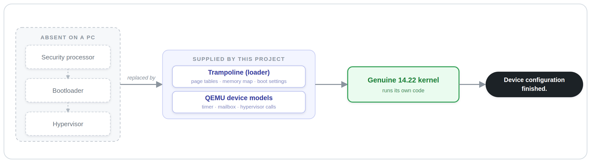

<div align="center">

# PS5-1422-REHOST

**The first publicly documented rehost of a current-generation console kernel on a PC.**

A genuine PlayStation 5 **14.22** kernel, booted under QEMU on an ordinary AMD machine with no
Sony hypervisor, far enough to finish configuring its devices — and a full account of everything
it took to get there.


<br/>



</div>

---

A PlayStation 5 and this PC are closer than they look. Both are x86-64 on AMD; the console's
kernel is a relative of FreeBSD. What stands between them isn't the processor — it's everything a
console does *before* the kernel runs. On real hardware a chain of earlier stages hands the kernel
a fully prepared world: its page tables, a map of memory, a description of the devices, a set of
boot settings, a hypervisor to call into. On a PC, none of that exists. QEMU gives you a CPU, some
RAM, and a serial port, and the kernel expects to wake up on a PlayStation.

So this isn't an emulator. The kernel is the real, signed retail build, and it executes its own
code. The work was to rebuild the world it expects to wake up in — and the kernel itself told us
what that world should contain, one failed check at a time. Every check it fails is a sentence of
a specification nobody ever wrote down; satisfy the check with what it was looking for, and the
kernel's own code carries on. Do that enough times, and it reaches the point where it announces
its devices are configured and its startup is, in its own terms, complete.

## Seeing it work

Near the end of the boot, the kernel prints its own banner and, a few hundred lines later, the
line we were after. This is its output, not ours — from
[`evidence/logs/session157r6-serial.log`](evidence/logs/session157r6-serial.log):

```console
SIE CONFIDENTIAL
Copyright (C) 2026 Sony Interactive Entertainment Inc.
...
r230580/releases/14.22 Oct 27 2026 02:17:44 amd64
...
Device configuration finished.
```

The complete, unedited logs for both runs are in [`evidence/logs/`](evidence/logs/) — including the
checkpoint that proves the kernel's own entry point executed.

## What's missing, and what we put in its place

Each stand-in is a small, honest lie, and every one is in the
[synthetic register](docs/synthetic-register.md) — what it fakes, what the kernel receives, and how
to remove it. None hides: each announces itself in the boot log. The kernel reaches its goal on
**62** such patches, the irreducible remainder for parts of the console QEMU cannot be (a secure
processor and its keys); how that was pared down to only what's load-bearing is the
[methodology](METHODOLOGY.md).

## What this is, and isn't, claiming

- **A documented rehost, not a demo.** A current-generation console kernel reaches device-config
  completion on a PC, and *every* departure from genuine console behaviour is written down with
  its address and the terms for undoing it. The accounting is as much the point as the boot.
- **A method other people can use.** Treat each crash as information, supply what the kernel asked
  for rather than deleting the check, and keep the result honest by proving the kernel really ran.
  The full approach and the complete toolchain are in [`METHODOLOGY.md`](METHODOLOGY.md).
- **A research instrument.** Getting this far exercises the kernel's device and driver code under
  a debugger. Anything found there is reported privately to the vendor and is deliberately not
  part of this release.

## Where to start

| If you want to… | Read |
|---|---|
| get oriented quickly, or check whether this is for you | [`docs/faq.md`](docs/faq.md) |
| understand how it was done and try the approach yourself | [`METHODOLOGY.md`](METHODOLOGY.md) |
| see exactly what was substituted, and why it's honest | [`docs/synthetic-register.md`](docs/synthetic-register.md) |
| run it against your own kernel | [`docs/reproducing.md`](docs/reproducing.md) |
| look up an unfamiliar term | [`docs/glossary.md`](docs/glossary.md) |
| read the full, unedited logs | [`evidence/logs/`](evidence/logs/) |

## What you won't find here

No firmware. There is no kernel or hypervisor image, no memory dump, no reconstructed code, no
keys, and no game content anywhere in this repository. You bring your own, legally obtained, 14.22
kernel and the harness builds around it; the identities and checksums of the artifacts used are
listed in [`docs/provenance.md`](docs/provenance.md) so a reproduction can be verified without
anything changing hands. There is no way to run a game here, and no path toward one.

<details>
<summary><b>Repository layout</b></summary>

```
PS5-1422-REHOST/
├── METHODOLOGY.md                the approach and the complete toolchain
├── ACKNOWLEDGEMENTS.md           firmware credit (KIMUNAKI) and thanks
├── docs/
│   ├── faq.md                    the common questions, answered plainly
│   ├── glossary.md               the project's vocabulary in plain terms
│   ├── synthetic-register.md     every substitution: what it fakes, what it returns, how to undo it
│   ├── reproducing.md            requirements, build, and run — bring your own kernel
│   └── provenance.md             artifact identities and checksums, scope, legality, disclosure
├── harness/
│   ├── MANIFEST.md               what each file is, and the exact build and run commands
│   ├── trampoline/               the loader that rebuilds the kernel's expected world
│   ├── qemu-device-models/       hardware modelled in QEMU (HPET timer + the hvmodel patch)
│   ├── boot/                     the boot and live-inspection scripts
│   └── analysis-index/           the static-analysis tooling used to read the kernel
└── evidence/
    ├── boot-markers.md           the banner and the finish line, quoted from the log
    └── logs/                     the complete logs of both runs
```

</details>

## Scope and ethics

This is security research and interoperability work on firmware obtained for that purpose. It
distributes no copyrighted code or keys and enables no piracy — there is no game, no content, and
no path to either. Findings that could affect users are disclosed privately to the vendor rather
than published. The full statement is in [`docs/provenance.md`](docs/provenance.md).

## Credits

Firmware supplied by **KIMUNAKI** ([@iamWitchKing](https://x.com/iamWitchKing)) — the 14.22 kernel
and hypervisor-service images this project rests on. The scope of that credit, the special thanks,
and the citation line are in [`ACKNOWLEDGEMENTS.md`](ACKNOWLEDGEMENTS.md).
